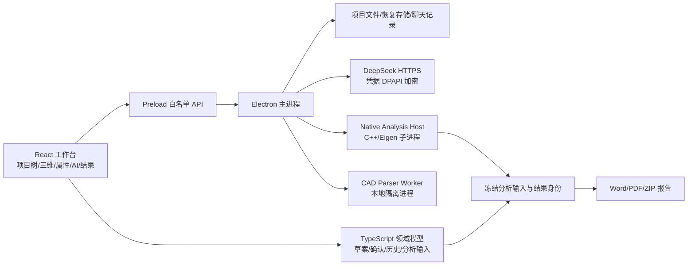

# FrameMind 技术架构与功能报告

**版本：** 2026-10-09  
**依据：** `README.md`、`PRD.md`、`PRD2.0.md`、`PRD2.5.md`、`PLAN.md`、`PLAN2.0.md`、`PLAN2.5.md` 及 `docs/decisions/` 中的 ADR。  
**文档定位：** 面向开发、测试、交付和技术评审的现状与路线报告。

## 1. 产品定位与当前边界

FrameMind 是面向空间钢刚架课程分析和工程建模的 Windows 桌面工作台。它把三维模型编辑、结构分析、结果查看、工程计算书和 AI 辅助操作放在同一个项目状态中。正式模型、分析输入、分析结果、AI 草案和历史任务具有独立身份，AI 通过受控工具访问工程状态，不能用聊天文本替代模型事实。

当前主线已经覆盖：

- 手动建立和编辑空间节点—杆件模型，保存并重开 `.framemind` 项目。
- 节点六自由度支座、节点力/力矩、杆件全局/局部均布荷载、自重、工况和用户自定义组合。
- 本地静力、内部细分、杆端弯矩释放、结构质量、模态、屈曲、弹性二阶和线性随机响应分析。
- 结果、过程矩阵、自由度映射、响应比较、可点击 AI 引用以及 Word/PDF 计算书导出。
- DeepSeek 工具调用、草案预览、用户确认、任务排队、取消、诊断副本、恢复和离线本地编辑/求解。

PRD2.5 继续规划三个真实闭环：指定 STEP 装配重建、固定场景的多 Agent 反向设计、自然语言建模到计算和恢复；项目级本地 Git sidecar 将贯穿三个闭环。截至本报告日期，PRD2.5 仍是需求和计划基线，不能视为全部交付完成。

## 2. 技术栈

### 2.1 桌面与前端

| 层次 | 技术/版本 | 职责 |
| --- | --- | --- |
| 桌面壳 | Electron `44.5.1` | Windows 窗口、文件对话框、IPC、凭据加密、原生进程和安装运行时 |
| UI | React、React DOM | 工作台、项目树、属性栏、AI 对话、结果和报告界面 |
| 语言 | TypeScript，目标 ES2022，严格模式 | 领域模型、UI、IPC 契约、工具 schema 和持久化边界 |
| 构建 | Vite `8.3.1`、`@vitejs/plugin-react` | 渲染进程开发服务器和生产构建 |
| 三维 | Three.js、`lucide-react` | 三维工程视图、节点/杆件/结果标记和图标 |
| 测试 | Vitest、Testing Library、Playwright | 单元、领域契约、组件、Electron 端到端和证据回放 |
| 打包 | electron-builder `26.17.0`、NSIS、Windows x64 | 可安装交付包和资源捆绑 |

Electron 主进程负责桌面能力和文件系统边界；渲染进程持有统一结构模型，通过启用 `contextIsolation`、禁用 `nodeIntegration` 的 preload 白名单访问受控 API。开发时需要 Node.js/npm；正式安装包内置 Electron 运行时，产品运行不需要用户另装 Node.js、Python、编译器或 CAD 软件。

### 2.2 原生数值核心

`native/` 使用 CMake、C++17 和 Eigen 3.4.0。核心可执行文件为 `framemind-core`，故障注入测试程序为 `framemind-fault-core`。MSVC 构建启用 `/W4`、UTF-8 和精确浮点选项，并使用静态 MSVC 运行库配置。

原生分析按能力拆分为静力、稀疏求解、内部网格、模态、屈曲、二阶和随机响应头文件。Electron 主进程通过受控 native host 启动子进程，传递冻结输入、阶段事件、结果和诊断；取消、崩溃、超时与资源不足不会直接污染正式项目。

### 2.3 依赖与产物

核心运行依赖包括 `react`、`react-dom`、`three`、`docx`、`pdf-lib` 和 `jszip`。生产构建形成 `dist/`、`dist-electron/`，原生核心放入 `native/`，CAD 解析 worker 放入 `cad/cad-parser-worker.mjs`，NSIS 安装包输出到 `release/` 或对应的交付目录。项目配置见 `package.json`、`vite.config.mts`、`electron-builder.yml` 和 `electron-builder.production-native.yml`。

## 3. 总体架构



领域层是工程事实的唯一来源，包含项目、节点、杆件、材料、截面、支座、荷载、工况、组合、分析工况、PSD 和分析结果。UI 只通过领域命令或任务入口改变它；AI 工具复用同一套校验和事务，不建立工具专用模型。

分析输入在启动求解时冻结，绑定项目 ID、模型修订号、单位、荷载来源、分析设置、网格策略和求解器版本。结果通过输入依赖判断 `current`、`expired` 或 `incomplete`，因此历史结果可以保留和比较，但不能冒充当前结果。

## 4. 项目格式与持久化

项目文件使用 `.framemind` 扩展名和 UTF-8 JSON。当前模型格式为 `framemind-project`，带版本号、稳定项目 ID、名称、时间、单位、模型 `revision`、节点/杆件稳定 ID、材料、截面、支座、荷载、工况、分析工况和历史分析结果。

单位契约的内部基准为长度 m、力 kN、力矩 kN·m；UI、工具和报告可以使用单位预设，但转换保持物理等价。节点 ID、杆件 ID、资源 ID 在保存和重开后保持稳定，显示编号与内部身份分离。

保存采用临时文件、旧文件备份、原子替换和失败恢复。自动恢复保存单独记录恢复来源；项目文件不保存完整会话聊天，凭据也不进入项目、分析快照、报告或普通日志。AI 快照只保留工程输入、选定对象、分析和比较所需内容，避免任务历史递归嵌套。

PRD2.5 计划为每个项目增加独立本地 Git sidecar。它将保存正式项目历史、checkpoint、候选分支、差异、回滚和证据索引，不操作 FrameMind 源码仓库，默认不远程 push。该机制仍需完成 P25-07/P25-08 及最终验收，当前不能按已交付能力使用。

## 5. 工作台与工具功能

### 5.1 工作台布局

当前工作台由左侧可折叠项目树、中间三维建模/结果区域、底部可独立收起并可拖动高度的属性与过程栏、右侧 AI 对话区组成。支持深色和浅色主题，主题同时作用于三维标记和原生标题栏，并在重启后保留。

项目树用于模型对象、工况、分析、结果和工程计算书入口；三维视图支持节点、杆件、真实截面、局部轴、荷载箭头、支座、结果变形和模态/屈曲形态显示。项目树选择和属性栏编辑共享同一应用模型。

### 5.2 建模与资源工具

- 节点：创建、坐标修改、批量移动、复制、删除、自由数值坐标和几何容差检查。
- 杆件：创建、端点/材料/截面/转角修改、批量转角、复制、删除、杆端局部弯矩释放。
- 拓扑：工作平面 XY/XZ/YZ 绘制、可控捕捉、显式连接和分割、近重合检查、成组节点合并。空间交叉不会自动成为连接。
- 材料与截面：常用钢材和型钢目录、来源元数据、自定义派生截面、五类参数化双对称截面、A/Iy/Iz/J 力学参数、真实截面渲染和分析线切换。
- 质量：节点点质量、杆件线质量和结构质量；自重由密度、面积和重力向量形成，避免重复计入。

所有手动和工具编辑经过统一领域校验。批量操作是事务，支持成组撤销/重做；共享截面修改会显示影响范围。

### 5.3 荷载、工况和分析准备

系统支持节点力/力矩、杆件全局或局部均布力、自重、多个独立荷载工况和用户自定义工况组合。组合系数允许零和负值，计算、切换、保存重开和比较均绑定原始荷载定义。分析工况进一步绑定分析方法和设置，可识别荷载、资源、网格、质量、阻尼或谱变化导致的结果过期。

随机分析使用显式 PSD 输入，记录激励量、频率单位、单/双边约定、频带、插值、频带外处理和谱点。工具和界面拒绝不完整或量纲不明确的谱输入。

### 5.4 分析功能

当前分析采用小变形 Euler–Bernoulli 空间刚接单元，并支持登记过的杆端弯矩释放和内部细分。主要能力如下：

1. **线性静力：** 节点响应、支座反力、杆端内力、均布荷载、自重和工况组合。
2. **内部细分与收敛：** 工程杆件保持用户拓扑，内部计算单元可细分；结果映射回工程杆件，并记录位移、反力和截面力误差。
3. **模态：** 由结构密度、附加点/线质量形成质量矩阵，输出频率和振型，支持模态阻尼和截断充分性检查。
4. **屈曲：** 固定预荷载加参考荷载的特征值屈曲，输出因子和形态；不把显示形态当真实位移，也不提供规范安全系数。
5. **弹性二阶：** 基于初始应力/几何刚度的线性结果比较；不收敛时明确失败。
6. **随机响应：** 单节点外力、杆件分布源、独立/同源源和整体一致平动基底激励，最低交付为选定节点平移分量的 PSD/RMS。

数值结果同时带分析 ID、输入修订号、来源工况/组合、求解器实现和阶段记录。分析 Worker 运行阶段包括模型检查、组装、求解和恢复；用户可取消，迟到结果不会覆盖后续编辑或切换后的项目。

### 5.5 结果、过程和报告

结果面板支持节点/杆件响应、分量和单位查看、响应比较、杆件沿程截面力查询、模态/屈曲形态、PSD/RMS 图表以及失败定位。杆件过程记录可显示局部轴、自由度映射、位移/荷载、局部和整体单元矩阵；整体过程记录可显示自由度编号、成员组装索引、约束/自由子系统和教材页码映射。

工程计算书从当前或历史分析冻结来源，包含模型图、理论边界、材料截面、支座、荷载、自重、组合、响应、过程附录和数据缺失说明。Word 可编辑，PDF 使用 Electron 内置排版并嵌入字体；随机响应另可导出完整数据 ZIP。导出过程在后台执行，正文和附录共享同一冻结来源。

## 6. Agent 系统

### 6.1 当前 Agent 基础能力

Agent 使用 DeepSeek 模型，通过 Electron 主进程发起 HTTPS 请求。当前设置支持模型选择、API Key 保存/更新/移除和连接测试；凭据通过 Windows DPAPI 加密，独立于项目文件。认证失败、限流、超时、网络错误和模型格式错误会进入可恢复失败，不会使用旧响应伪装成功。

AI 请求开始时捕获工程快照：项目 ID、模型修订、选择对象、分析 ID、分析当前性和必要的工程输入。工具回执同时包含工具调用身份、项目/对象身份、输入版本、项目状态、分析状态和结果引用。

### 6.2 工具分层

只读工具主要包括：

- `read_selection`、`read_model`、`read_objects`：按对象、集合、分页、字段和条件读取正式模型。
- `read_result`/结果读取与比较：引用节点、杆件、分量、数值、单位、工况/组合和冻结输入。
- 诊断读取、近节点检查、节点合并影响检查和工程条件读取。

变更工具先生成草案或提案：

- `propose_model_edits` 及节点/杆件创建、修改、复制、删除操作。
- `propose_task`：把几何、资源、支座、荷载和分析意图收敛为一份完整任务草案。
- `propose_frame`：两层空间刚架方案预览。
- `propose_analysis_conditions`：工况、组合、均布荷载、自重和分析条件预览。
- `propose_section_change`：对选定柱组提出截面变更并绑定前后分析比较。
- `create_diagnostic_copy`、`run_diagnostic_trial`、`compare_diagnostic_trials`：在隔离副本内验证假设。

正式修改必须经过用户确认，确认时再次检查项目 ID、模型修订、草案版本、对象身份和冲突。确认是原子操作，带幂等回执；失败时正式模型保持原状。已请求“建模并计算”时，建模确认后才准备分析条件，条件确认后继续本地求解。

### 6.3 Agent 可靠性与恢复

任务系统支持单项目单主任务、补充消息归并、独立任务排队、稳定目标、人工编辑协调、诊断副本、预算、暂停/取消和跨重启恢复。取消、切换项目、模型修订变化或目标冲突会使旧请求失效；重试使用新任务 ID 并关联原任务。未确认草案保持未确认，已提交修改不会因旧重试重复应用。

Agent 的权限边界包括：不能执行任意脚本、PowerShell、自由 shell 或源码 Git；写入必须通过白名单服务；结果必须绑定任务目录、父快照、输入哈希、超时和输出 schema。AI 解释会区分计算事实和原因推断，不提供规范合规结论。

### 6.4 PRD2.5 计划中的多 Agent 反向设计

PRD2.5 将反向设计限定为“位移约束下的截面减重演示”，不是强度、屈曲或规范设计验算。固定输入为两层空间钢架：X 一跨 6 m、Y 一跨 4 m、两层各 3 m、12 节点、16 杆件、S355JR、HEA200/IPE200、底层全固定、自重和演示外荷载；目标是总质量最小且最大水平合位移不超过 15 mm。

计划架构为：

1. **main agent** 读取真实父快照，拆分任务、比较候选、决定下一轮和受控合并。
2. **3 个 work agent** 每轮基于同一父快照并行运行，分别探索激进减重、稳健缩小和独立策略；各自拥有独立任务 ID、候选快照和输出目录。
3. **inspect agent** 只读检查候选，重新核对资源、刚度可解性、最大水平位移、整体力/力矩平衡和质量来源。
4. **程序门槛优先于文本意见。** 任何非有限、来源错配、奇异/病态、位移超限或平衡残差超限候选均为 `infeasible/blocked`，不能合并。

预算为每个 work 最多 120 秒、最多 2 次工具重试，inspect 最多 90 秒，最多 8 轮或 20 分钟。成功停止要求存在可行候选且连续两轮没有找到更轻方案；预算耗尽不能称为收敛或全局最优。P25-10 至 P25-13 及最终在线证据尚未完成。

## 7. STEP 导入与项目 Git 计划

指定输入为仓库中的《完整钢架装配.STEP》，P25-01 已登记文件大小和 SHA-256，但独立 CAD 基准尚未完成。P25-02 已有隔离解析入口和最小真实读取；P25-03 已形成版本化中间态和确定性哈希。后续仍需完成中心线/拓扑预览、截面和材料核验、用户确认、正式项目应用、项目 Git sidecar、候选分支和恢复。

规划中的 STEP 流程是：

```text
文件菜单/拖放
  → 导入前 checkpoint
  → 隔离本地 CAD 进程
  → 版本化中间态 JSON
  → 程序确定性检查
  → AI 只读语义核验
  → 预览、材料/刚接补齐和用户确认
  → 原子应用到 .framemind
  → 保存、重开、来源映射和 Git checkpoint
```

AI 只能接收脱敏摘要、必要数值和实体标识，不接收 STEP 字节、完整 BREP、本机绝对路径或凭据。支座和荷载可以在导入后缺失，但材料、截面和刚接假设必须明确确认；未具备求解条件时界面必须显示未就绪。

项目 Git 计划采用 sidecar 目录保存正式主线、checkpoint、候选分支、差异和证据索引。候选以父快照为基准，正式模型改变后自动过期；冲突不做静默三方合并，回滚通过受控接口完成并重新核对分析结果有效性。

## 8. 安全、隐私与故障隔离

- Renderer 不直接获得 Node.js 文件系统权限；文件、网络、原生进程和凭据都经过 preload/IPC 边界。
- API Key 使用 Windows DPAPI 加密，项目文件、Git、报告、AI 请求和普通日志不保存明文凭据。
- CAD 原始文件和完整 BREP 保留在本机；发送给 AI 的摘要脱敏并去除绝对路径。
- 原生求解和 CAD 解析均使用隔离子进程；超时、崩溃、资源不足和取消有明确阶段和失败状态。
- AI 工具采用白名单、严格字段校验、任务身份和输出 schema；未知工具或自由命令被拒绝。
- 正式模型与诊断副本、候选快照、历史结果、草案和回执分离，错误候选不能污染正式结果。

## 9. 验证、性能与交付证据

验证分为五层：领域单元测试、组件测试、原生/数值回归、Electron 端到端回放、真实在线联测和安装验证。回放、截图、整体测试绿色和文档声明不能互相替代；真实 AI、独立数值参考、目标规模性能和干净 Windows 安装分别登记。

当前已登记的代表性证据包括：T2-38 随机响应计算书和数据导出、T2-40 全分析独立数值验收、T2-41 工具覆盖与小样本真实 Agent 联测、T2-43 自动化完整桌面主线。README 明确指出真人首次试用、完整目标规模验收和干净 Windows 最终交付仍未全部完成。

性能基线在固定 Windows 11、i7-14650HX、16 GB 环境测量。既有 T32 对 58、399、1,120 杆模型记录了求解和 Word/PDF 指标；计划中的 T2-42 进一步使用约 1,000 节点/3,000 杆模型登记交互、取消、分析、内存和资源失败门槛。原生核心和 Electron 进程内存分开计量，预算耗尽和缺失遥测必须保留为失败或未测量。

标准验证命令包括：

```powershell
npm ci
npm run typecheck
npm test
npm run test:e2e
npm run build:native
npm run build
npm run package:win
```

按功能还可运行 `npm run evidence:t31`、`npm run evidence:plan2:t240`、`npm run evidence:t32`、`npm run evidence:t33`、`npm run evidence:t34` 及 PLAN2.0/PLAN2.5 对应证据命令。在线命令会产生 DeepSeek API 用量，并与离线回放分开记录。

## 10. 当前状态与后续优先级

| 能力 | 当前判断 | 主要依据 |
| --- | --- | --- |
| 桌面壳、项目格式、基础建模 | 已实现并有确定性验证 | ADR-0001、README、T01-T08 |
| 静力和原生分析通路 | 已实现；部分综合性能/安装验收待补 | PLAN2.0 T2-12—T2-15、README |
| 模态、屈曲、二阶、随机响应和报告 | 已实现并有独立数值/导出证据；综合验收仍按任务边界执行 | PLAN2.0 T2-27—T2-40 |
| Agent 工具、确认、结果引用、诊断与恢复 | 已实现；真实联测为固定样本，不代表总体成功率 | PLAN2.0 T2-01—T2-11、T2-41、ADR-0044/0073 |
| 指定 STEP 最小解析与确定性中间态 | 部分完成 | PLAN2.5 P25-01—P25-03 |
| STEP 拓扑、资源核验、正式应用 | 计划中 | PLAN2.5 P25-04—P25-06 |
| 项目 Git sidecar、候选分支、回滚 | 计划中 | PLAN2.5 P25-07—P25-08 |
| main/work/inspect 多 Agent 反向设计 | 计划中 | PLAN2.5 P25-09—P25-13 |
| 自然语言完整三闭环和三包证据 | 计划中/待综合验收 | PLAN2.5 P25-14—P25-18 |
| 干净 Windows 最终交付和真人试用 | 尚未全部完成 | README、PLAN2.0 T2-42—T2-44 |

建议的推进顺序是：先完成 P25-01 的独立 CAD 基准和 P25-04—P25-06 的 STEP 正式应用，再实现 P25-07—P25-08 的项目 Git 一致性边界；随后实现 P25-09—P25-13 的真实多 Agent 候选/检查/停止闭环，最后收口 P25-14—P25-18 的三条桌面主线、隐私失败验证、干净 Windows 安装和证据包。

## 11. 明确的产品边界

当前产品和 PRD2.5 均不承诺任意 STEP 自动重建、任意代码执行、Timoshenko 梁、任意非对称截面、半刚性连接、板壳/实体、塑性、极限承载力、后屈曲、规范验算、Rayleigh 阻尼、非平稳随机时程、一般互谱矩阵或多支座差动/转动基底激励。反向设计展示只说明有限预算下的位移约束截面减重过程，不能解释为全局最优或工程设计合格结论。

